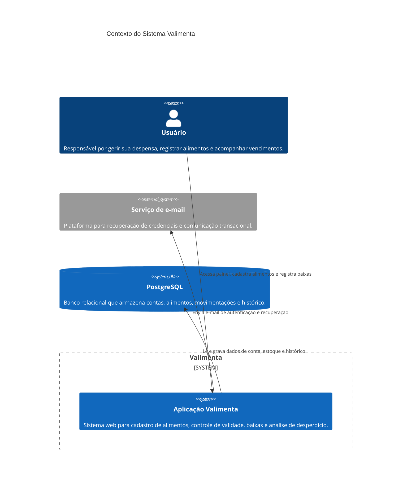
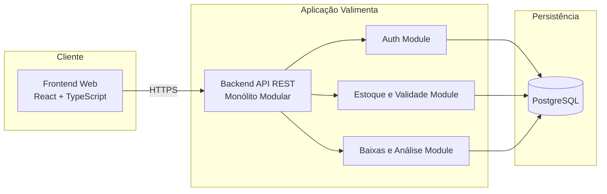
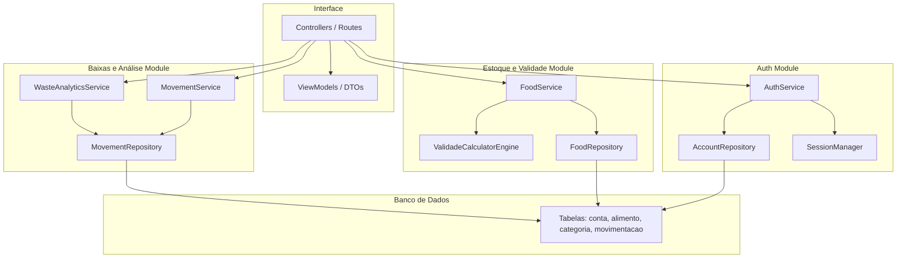
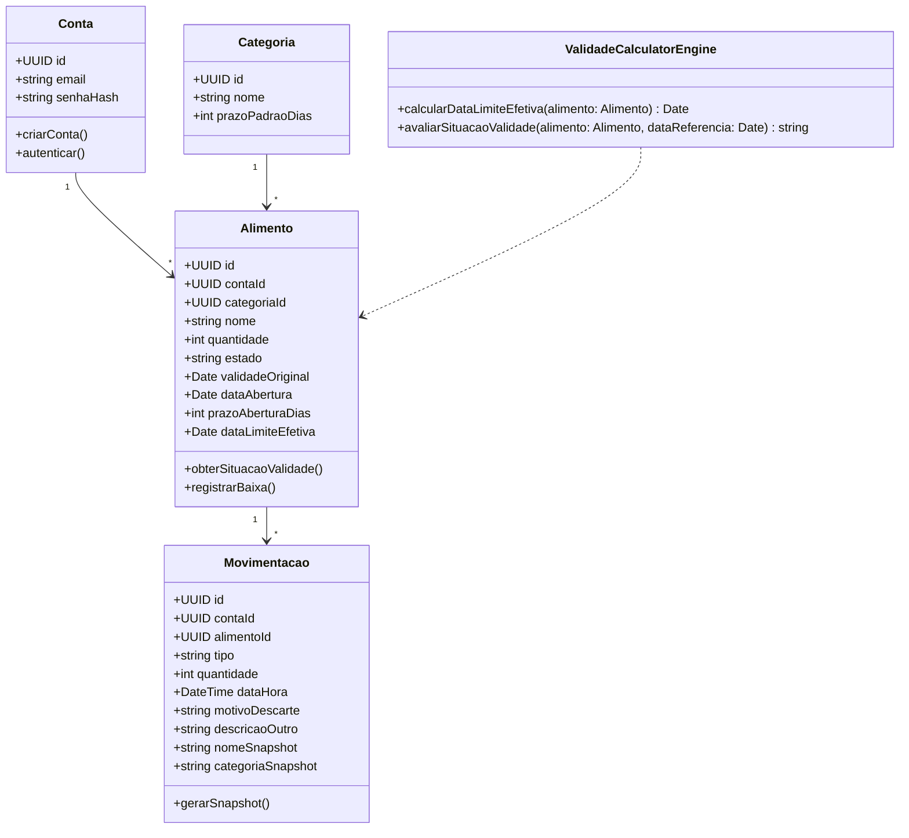

# Projeto Arquitetural — Modelo C4

> **Sistema:** Valimenta — Controle Doméstico de Validade de Alimentos  
> **Escopo:** MVP da aplicação web de gestão de alimentos, validade e desperdício  
> **Arquitetura adotada:** Monólito modular com backend em camadas, frontend SPA e banco relacional PostgreSQL

---

## Visão geral

O modelo C4 organiza a arquitetura em quatro níveis de abstração, permitindo descrever o sistema desde o contexto geral até a estrutura interna das classes e regras de domínio. Para o Valimenta, a escolha arquitetural já definida no ADR é um monólito modular, com separação funcional em módulos e persistência relacional.

---

## Nível 1 — Contexto

Este nível mostra a fronteira do sistema com seus usuários, agentes externos e dependências de infraestrutura.

### Descrição

- O principal ator do sistema é o usuário residencial que administra a despensa pessoal.
- O sistema central é a aplicação Valimenta, responsável por gestão de contas, alimentos, validade e baixas.
- O banco de dados relacional garante consistência transacional e isolamento lógico entre contas.
- A comunicação com e-mail é tratada como dependência externa, sem tornar o sistema distribuído.

---

## Nível 2 — Contêineres

Neste nível, a aplicação é vista como conjunto de contêineres de software e infraestrutura tecnológica.

### Descrição

- O frontend é uma SPA em React, responsável pela interface e pela interação com o usuário.
- O backend é um monólito modular, dividido em módulos funcionais para autenticação, estoque/validade e baixas/análise.
- O PostgreSQL atua como base única de persistência, preservando atomicidade e isolamento por conta.
- A arquitetura prioriza simplicidade operacional e entregabilidade no MVP, sem introduzir microsserviços.

---

## Nível 3 — Componentes

Este nível detalha os principais componentes internos do monólito modular e suas responsabilidades.

### Componentes principais

- AuthModule: autenticação, autorização e isolamento de dados por conta.
- InventoryModule: cadastro de alimentos, cálculo de validade, estado, filtros e consulta.
- MovementModule: baixa de itens, registro de movimentações e histórico imutável.
- ValidadeCalculatorEngine: componente de domínio puro, responsável por calcular data limite efetiva e situação de vencimento.
- WasteAnalyticsService: consolida dados de consumo e descarte para painel de desperdício.

---

## Nível 4 — Código (Diagrama de Classes)

Este nível representa as entidades e relações centrais do domínio do sistema, com foco em regras de negócio e persistência.

### Regras refletidas no modelo

- Cada conta possui um conjunto próprio de alimentos e movimentações, preservando isolamento multiusuário.
- Uma categoria descreve o prazo padrão sugerido para alimentos do mesmo tipo.
- Alimento representa o item do estoque, com quantidade, estado, validade original e data limite efetiva.
- Movimentacao registra eventos imutáveis de consumo ou descarte, preservando o histórico da despensa.
- ValidadeCalculatorEngine encapsula a lógica de cálculo da data limite e da situação de vencimento, mantendo o domínio desacoplado de frameworks.

---

## Conclusão

O Modelo C4 do Valimenta demonstra que a solução segue a arquitetura escolhida no ADR: monólito modular, organizado por módulos de domínio e persistência relacional. A representação em níveis de contexto, contêineres, componentes e classes permite que a equipe tenha uma visão clara da estrutura do sistema e do alinhamento com os requisitos funcionais e não funcionais.
